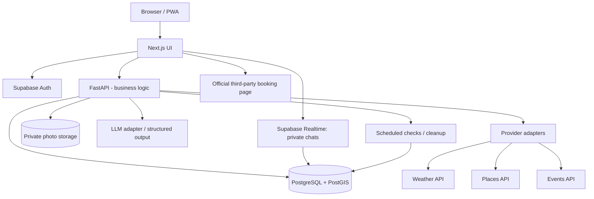

# SOLOQUEST — DEVELOPMENT BLUEPRINT
**Tagline:** Start Alone. Connect Naturally. Explore Freely.

**Version:** 1.0 | **Pilot city:** Berlin | **Team:** You + Manassawin | **Planning assumption:** 20–25 engineering hours per person/week | **Target:** ~12 weeks to private beta, +2–4 weeks for a controlled public pilot.

> Outcome: a responsive web/PWA in which a person signs up, creates a profile, discovers activities, receives and edits a realistic AI itinerary, explores solo or opts into social plans, requests to join, chats for an activity, and replans around changing conditions. Events can open official ticket/booking checkout links. Native ticket purchasing is **not** in the MVP unless a partner grants appropriate API access.

## A. Feature scope and release criteria

### BUILD NOW — 11 features
| # | Feature | Required user-facing behavior | Acceptance test |
|---|---|---|---|
| 1 | Profile creation | Sign in, display name, optional photo, interests, city/approximate location, short bio, social opt-in | Edit, save, reload and delete profile; unauthorised users cannot modify it |
| 2 | AI day planner | Select city, date, mood, budget, time window, interests; get plausible agenda | All suggested activities fit the selected time window, budget and city, or clearly flag uncertain items |
| 3 | Itinerary customisation | Add, remove, reorder, change times, pin activities, replace suggestions | All edits persist and avoid accidental overwrite during replanning |
| 4 | Discover nearby | Filter events and venues by city/approximate area, category, date and affordability | Provider results show source, date, location, booking URL and last-checked info |
| 5 | Solo or Social | Toggle solo and social discovery for each itinerary/session | Solo mode never exposes the user's activity to other users |
| 6 | Shared itinerary viewing | View only specific activities shared by approved viewers, co-participants or via explicit share link | A private activity remains hidden even if another activity on that itinerary is public |
| 7 | Temporary event group chat | Accepted outing participants can talk in real time, with expiry | Non-members cannot view/send messages; membership access stops after exit/expiry |
| 8 | Request to join | Request to join a visible activity; owner accepts/declines | Request alone reveals no private details or group chat; acceptance creates membership |
| 9 | Weather/plan replanning | User requests replan or acts on weather-change prompt; preserve pinned commitments | Changed activity is replaced; pinned appointments and approvals survive; changes previewed before saving |
| 10 | Ticket/booking integration | Open official external booking or ticketing page, show clear handoff | Click opens correct vendor checkout; no claim that a ticket is booked until provider confirms |
| 11 | AI group outings | Eligible opted-in users receive a shared outing suggestion; accept independently | A group is created only after required explicit acceptances; no automatic exposure of locations |

**Safety must ship in V1:** private by default, activity-level sharing, block/report, age gate (initially 18+), no exact live location broadcasting, group membership authorisation, account/data deletion, consent for location access, abuse rate limits. These are foundations, not optional 'advanced privacy' features.

### FUTURE (not on the 12-week critical path)
Granular privacy/audience settings and full mutual friend graph; private DMs after mutual connection; quests and XP; preference learning from ratings; transport routing; loyalty rewards and paid tier; deeper verification and trust systems. Keep the schema extensible without implementing these now. **Note:** basic privacy, blocking and reporting cannot wait.

## B. Stack and why
- **Web/PWA:** Next.js, React, TypeScript, Tailwind. One responsive codebase for browser and mobile web. Do not start with separate iOS/Android apps.
- **Application API:** Python FastAPI, Pydantic, SQLAlchemy and Alembic. Keep AI orchestration server side.
- **Data + identity:** Supabase PostgreSQL with PostGIS, Supabase Auth, private storage for user uploads; enforce RLS and API checks. Store timestamp in UTC, display in venue/user local timezone.
- **Chat:** Supabase Realtime *private* Broadcast channels, backed by messages in Postgres; short-lived rooms and cleanup jobs. Realtime is transport, not data access policy.
- **AI:** provider-agnostic hosted LLM adapter; return validated structured JSON, not free-form text for itinerary state. Prefer a strong hosted model for MVP to avoid the cost of managing an LLM server.
- **Provider adapters:** Ticketmaster Discovery (events); Google Places Nearby Search (venues; paid/terms-dependent); Open-Meteo (forecast; free license is noncommercial only); external checkout URLs for tickets.
- **Ops:** Vercel web; managed container hosting for API; Sentry/error monitoring; GitHub Actions CI; secret manager; optional Redis cache/queue once needed.

**Provider restrictions:** Do not rely on the discontinued public Eventbrite event-search endpoint. Google Places has field-based pricing, storage and display rules; save permitted identifiers, not arbitrary provider payloads. Open-Meteo free API is non-commercial only. Native Ticketmaster checkout requires restricted Partner API access. Use adapter interfaces so providers can be replaced.

## C. Logical architecture

**Rule:** The AI never executes bookings, grants chat access or publishes someone's plans. FastAPI validates those actions with deterministic rules and the user's explicit approvals.

## D. Data model (minimum tables)
1. `profiles`: auth user ID, display name, bio, city, optional approximate area, photo path, onboarding status, social opt-in.
2. `profile_interests`: profile ID, interest ID; `interests`: canonical labels/categories.
3. `itineraries`: owner ID, date, timezone, mood, budget currency/amount, mode = SOLO/SOCIAL, status, sharing defaults.
4. `activities`: itinerary ID, order, title, place/event provider reference, start/end UTC, timezone, expected cost, pinned flag, visibility PRIVATE/SHARED, status, coordinates where needed.
5. `catalog_items` / `provider_refs`: normalised third-party event/place references, source, fetched_at, expiration/TTL; follow licensing rules.
6. `share_grants`: itinerary/activity scope, viewer ID or expiring opaque invitation, permissions and expiry.
7. `join_requests`: requester, activity, status PENDING/ACCEPTED/DECLINED/CANCELLED/EXPIRED, decision timestamp; prevent duplicates.
8. `outings`: proposal or meetup details, creator/host, start/end time, max capacity, status.
9. `outing_members`: outing, user, RSVP status, joining/leaving time; composite uniqueness.
10. `chat_rooms`: outing ID, expiry, status; `chat_messages`: room, author, content, created_at, soft-deleted flag/retention date.
11. `notifications`: user, type, read status, payload with minimum identifying data.
12. `user_blocks`, `reports` and `audit_events` for safety, review and integrity.

**Access examples:** Owner manages own itinerary; a viewer sees only items allowed by a share grant or explicit activity visibility; join requests visible to requester and host; outing membership is required for chat; blocking prevents discovery/join/contact. Enforce using SQL policies and server authorisation tests—not frontend-only hiding.

## E. API contract (agree on this in week 1)
- `POST /v1/profile` / `GET /v1/profile/me` / `PATCH /v1/profile/me`
- `GET /v1/discover?city=&lat=&lon=&radius_km=&date=&category=`
- `POST /v1/itineraries/generate` — structured constraints in, validated draft out
- `GET /v1/itineraries/:id` / `PATCH /v1/itineraries/:id`
- `POST /v1/itineraries/:id/activities` / `PATCH /v1/activities/:id` / `DELETE /v1/activities/:id`
- `POST /v1/itineraries/:id/replan` — preview changes, then separate commit
- `POST /v1/activities/:id/share` / `GET /v1/social/feed` — authorised public/shared view only
- `POST /v1/activities/:id/join-requests` / `PATCH /v1/join-requests/:id`
- `POST /v1/outings/suggest` / `POST /v1/outings/:id/rsvp` / `POST /v1/outings/:id/leave`
- `GET /v1/outings/:id/chat` / `POST /v1/outings/:id/messages` — persists messages, broadcasts to room members
- `GET /v1/events/:id/booking-link`
- `POST /v1/users/:id/block` / `POST /v1/reports` / `DELETE /v1/account`

Return documented errors (`401`, `403`, `404`, `409`, `422`, `429`) and stable IDs. Publish OpenAPI JSON for frontend mocks. All writes are idempotent where retries could duplicate join requests or chat messages.

## F. AI system design
### Planner pipeline
1. Gather explicit user constraints: city, date, available clock hours, total budget, interests, mood, mobility preference if supplied, SOLO/SOCIAL.
2. Fetch relevant **real** events/venues and weather in that city/time window; attach provider freshness and details.
3. Filter invalid candidates using deterministic checks: dates, opening/venue hours where known, geospatial proximity, category fit, available budget and exclusions.
4. Rank candidates with a simple weighted scoring model for interest/mood match, time fit, rough proximity and cost.
5. Send a limited list of real candidate IDs to the LLM; request JSON `[{candidate_id, start_at, end_at, estimated_cost, rationale}]` plus optional text explanation.
6. Validate the returned JSON with Pydantic, reject bad IDs, duplicate times, out-of-range budget, or implausible travel windows; re-rank/repair or return a safe fallback.
7. Save a **draft** itinerary; show uncertainties (price, hours, ticket availability), and require user confirmation.

Start without a complex multi-agent framework. Add separate recommendation, weather and social matching modules only after this single pipeline works.

### Weather/plan changes
- Poll cached forecasts periodically only for active sessions, or trigger on user action.
- Detect e.g. expected rain during an outdoor stop or user-removed activity.
- Preserve `pinned = true` and explicitly accepted social meetups by default.
- Offer replacement options and a **diff preview**; user accepts changes to publish them.
- For an outing shared with others, do not silently change everyone else's schedule; propose/notify and gather consent.

### Social match score, v1
Filter **only opted-in** users who chose SOCIAL, are age-eligible, not blocked, and have intentionally shared a compatible activity. Then score overlapping **time windows**, shared interests, similar budget, reasonable radius and explicit group-size preferences. Use transparent rules; LLM can phrase an invitation but should never select or reveal hidden participants from private plans.

### AI-proposed outings
Given a group of opted-in compatible candidates, propose a concrete public activity (e.g., café at 18:30). Show each user approximate neighbourhood, time, number of proposed participants and activity; create an outing only once two or more have accepted. No chat or participant identity is exposed before permitted acceptance.

## G. Detailed implementation milestones (two developers in parallel)

### Week 1 — Product contract, design and repository
**You:** create backend project, Docker/dev environment, DB migrations, Supabase setup, OpenAPI stubs and auth verification. Draw schema, write backend tests for ownership permissions.
**Manassawin:** wireframes and responsive design system; define pages: landing/login, onboarding, home, discover, planner, itinerary, social feed, request inbox, outing chat, settings. Build mock UI and share Figma/screenshots.
**Deliverable:** both apps run locally, one GitHub repository, CI checks pass, agreed API response types and sample fixtures.

### Week 2 — Authentication and profiles
**You:** Auth token validation, photo upload policies, profile CRUD, input sanitation, delete account basics, RLS tests.
**Manassawin:** login/signup, onboarding, photo/interests/bio/city edit and responsive UI states.
**Deliverable:** real profile survives reload and stays private to owner except approved public fields.

### Week 3 — Events, places and weather discovery
**You:** provider interfaces, Ticketmaster connector, Places connector, weather connector, normalized responses, fallback/mock catalog, TTL cache and rate limits. Keep API keys server-side.
**Manassawin:** discovery page with search/filter, cards, event detail page, provider links, empty/error/loading states.
**Deliverable:** real Berlin searches, verifiable dates and source links. If external quota is exhausted, clearly marked demo fixtures work.

### Weeks 4–5 — AI itinerary + editing
**You:** planner ranking and schema validation, generation endpoint, CRUD endpoints, constraint engine, cost/time checks, AI cost logs and fallback plan.
**Manassawin:** mood/budget/time form, itinerary timeline, reorder/add/delete/edit, pin/unpin, draft acceptance and itinerary details.
**Deliverable:** user generates a day plan, customises it and sees the same plan after sign-out/in. Test invalid budgets, closed venues, missing events, no AI response.

### Week 6 — Solo/Social, activity sharing and feed
**You:** per-activity visibility, opt-in gating, share grants, social feed query, access tests, block rules.
**Manassawin:** Solo/Social toggle, 'Share activity' controls, view permitted daily plans, sharing indicators.
**Deliverable:** hidden activity cannot be retrieved by URL, SQL client or API; only explicitly permitted activities appear.

### Weeks 7–8 — Join requests + temporary event chats
**You:** join request state machine, accepting/declining, race-safe outing membership, messages persistence, private room channel authorisation, room expiration and retention cleanup.
**Manassawin:** request/approval notifications, participant list, chat layout, leave outing action and polite-exit flow.
**Deliverable:** 3–5 test accounts join an activity, chat, leave and lose room access. Unauthorised users fail to subscribe to room or read messages. Friendly exit text is optional and user-controlled.

### Week 9 — AI group outing recommendations
**You:** deterministic compatibility filtering, overlap score, proposal creation, opt-in invites, capacity and RSVP state transitions.
**Manassawin:** outing suggestion cards, accept/skip screens, group summary and RSVP status.
**Deliverable:** three compatible opt-in users independently accept a meetup; decline/block/expiry do not create unwanted groups.

### Week 10 — Replanning + bookings handoff
**You:** weather change detector, replan preview endpoint, hard constraints, preserved commitments, event checkout URL validation and outbound tracking without storing payment credentials.
**Manassawin:** weather prompt, before/after itinerary comparison, 'Apply changes', 'Get tickets' handoff and vendor disclaimer.
**Deliverable:** rainy outdoor activity is replaced without touching pinned dinner; user can open a legitimate ticket provider page.

### Week 11 — Reliability, privacy and abuse testing
**You:** row-level/database/API access audits, rate limits, logs without sensitive geodata, deletion/export workflow, provider error handling, migrations/backup plan, API load tests.
**Manassawin:** E2E browser tests, keyboard/accessibility pass, mobile viewport testing, loading/offline handling, usability study with test participants.
**Deliverable:** all critical security and acceptance cases pass; basic report/block affordances exist.

### Week 12 — Private beta and deployment
**You:** hosted API, DB deployment, secrets, monitoring, CORS rules, deployment documentation, endpoint smoke tests and rollback.
**Manassawin:** Vercel web deployment, app analytics with privacy-aware settings, product walkthrough, user feedback form and bug triage.
**Together:** invite 15–30 beta testers, manually review privacy and meet-up safety edge cases, run one end-to-end scenario with real data.
**Deliverable:** URL-based working beta, monitored error rate, no known critical security issues, reproducible setup guide.

### Weeks 13–16 (optional, recommended) — Pilot hardening
Fix observed matching errors; widen event coverage; make recommendations robust when provider results are thin; assess content moderation and escalation; improve accessibility and mobile usability; review EU legal documentation and processors; add backup/restore drill; run a small supervised Berlin pilot rather than a mass public launch.

## H. Every-feature Definition of Done
A ticket is complete only when: (1) the UI works on desktop and mobile; (2) API+DB persistence works; (3) authenticated permissions and RLS are tested; (4) error/empty/loading flows work; (5) unit/integration tests pass; (6) the feature is documented; and (7) the other developer has approved the PR. **A mock screen alone is never 'done'.**

## I. GitHub workflow and coordination
- Single GitHub repo: `apps/web`, `services/api`, `packages/contracts`, `supabase/migrations`, `tests`, `docs`.
- `main` protected; branches: `feat/profile-api`, `feat/profile-ui`, etc.
- One issue per vertical feature. Agree JSON contracts and fixtures **before** parallel implementation.
- Daily 15-minute check-in; one integrated demo each Friday; planning/retrospective each Monday.
- Review each other's PRs; never push unreviewed changes directly to main.
- Issue labels: `backend`, `frontend`, `ai`, `security`, `integration`, `blocked`, `bug`, `future`.
- Cross-check: Manassawin runs backend API examples against UI; you run user flows and review permissions/AI realism.

## J. End-to-end launch test scenario
1. User A registers and adds photo, bio, interests and Berlin as a city.
2. User A picks Fri 17:00–23:00, €30, relaxed mood; planner returns a structured, sourced itinerary.
3. User A changes a venue, pins one dinner, saves.
4. User A changes SOLO to SOCIAL and shares **only** the café activity.
5. User B sees the café activity but **cannot** see pinned private dinner; B requests to join.
6. A accepts; B gets a temporary group chat and café activity is added to B's own itinerary if B approves.
7. User C opts in to the same time/interests; AI proposes a shared outing; members accept individually.
8. A leaves the outing using an optional polite exit; A's chat access is revoked.
9. Weather shows rain; A reviews a replacement activity without changing pinned dinner or others' plans.
10. A taps tickets on a sourced event and is sent to an official vendor purchase page.
11. After group expiry, chat becomes inaccessible; retention/deletion jobs behave as documented.
12. Blocked user cannot access private plans, join requests or private chats.

## K. Main risks and decisions
| Risk | Mitigation |
|---|---|
| External events missing/incorrect | Provenance, refresh timestamps, multiple provider adapters, clear 'not verified' labels |
| LLM hallucination or impossible timeline | AI can pick only fetched IDs; deterministic time/budget checks; fallback recommendations |
| Safety or unwanted contact | Opt-in matching; 18+ initial policy; no raw live GPS; report/block; confirmed group membership |
| Accidental disclosure | Private-by-default RLS; per-activity grants; negative-permission tests; expiring tokens |
| Too much work for two people | One mobile-responsive web app; no native apps, chat DMs, XP or routing in V1 |
| Booking integration restrictions | Outbound official booking links only; do not claim native purchases |
| Provider cost/licensing | Quotas, cache rules, minimal fields, API spend caps and partner pricing review |
| Chat spam / moderation | Rate limits, report/block, remove user, operational moderation procedure |
| Shared-plan races | Version numbers, optimistic concurrency, explicit acceptance for affected participants |

## L. First-day setup checklist
- [ ] Agree that Berlin, adult users and one responsive web app are the MVP.
- [ ] Create repo, issue board and two protected reviewer roles.
- [ ] Create Figma screens for onboarding, itinerary and join/chat happy path.
- [ ] Register Supabase staging project; enable authentication; plan RLS policies.
- [ ] Make FastAPI starter with `/health` and OpenAPI; Next.js starter with home/login.
- [ ] Write tables/migrations and shared request/response JSON examples.
- [ ] Decide LLM provider and set modest spend caps.
- [ ] Obtain Ticketmaster key, Google Places project/billing, weather provider terms review.
- [ ] Assign Week 1 issues with clear owners and one Friday demo.

## Reference documentation and service terms
- Ticketmaster Discovery API: https://developer.ticketmaster.com/products-and-docs/apis/discovery/v2/
- Ticketmaster Partner API: https://developer.ticketmaster.com/products-and-docs/apis/partner/
- Google Places Nearby: https://developers.google.com/maps/documentation/places/web-service/nearby-search
- Google Places policies: https://developers.google.com/maps/documentation/places/web-service/policies
- Open-Meteo terms: https://open-meteo.com/en/terms
- Supabase Realtime authorization: https://supabase.com/docs/guides/realtime/authorization
- EU privacy by design/default: https://commission.europa.eu/law/law-topic/data-protection/information-business-and-organisations/obligations_en

---
**Final release condition:** SoloQuest is complete for the defined MVP when the entire launch test scenario is repeatable with real accounts, real discovery provider results, a working AI draft and edit cycle, private social joins, temporary chat, safe replanning, and official booking handoff. Future features remain separate releases.
